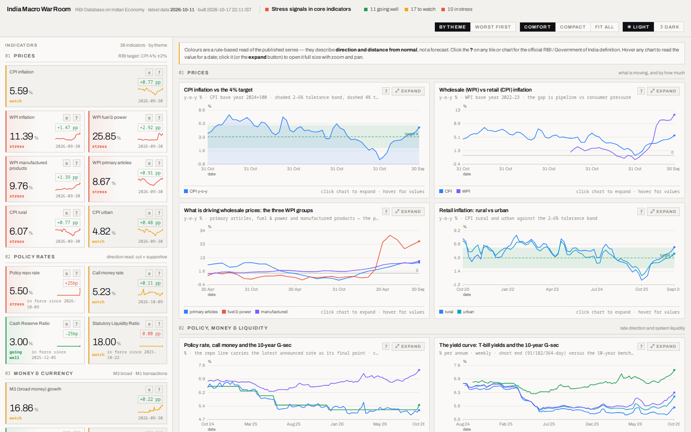
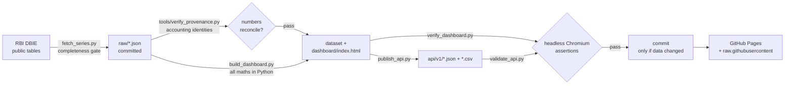

# India Macro War Room

**A daily-refreshed dataset, static API and at-a-glance dashboard for 38 widely-watched Indian
macroeconomic indicators — built from the Reserve Bank of India's public publications.**

[](https://github.com/mayankmohan1992/india-macro-war-room/actions/workflows/ci.yml)
[](https://github.com/mayankmohan1992/india-macro-war-room/actions/workflows/daily.yml)
[](LICENSE)
[](https://www.python.org/)
[](https://data.rbi.org.in/)

| | |
|---|---|
| **Dashboard** | https://mayankmohan1992.github.io/india-macro-war-room/ |
| **API base (CORS-enabled)** | `https://raw.githubusercontent.com/mayankmohan1992/india-macro-war-room/main/api/v1/` |
| **API mirror (Pages)** | `https://mayankmohan1992.github.io/india-macro-war-room/api/v1/` |
| **Reference** | [API](docs/API.md) · [Methodology](docs/METHODOLOGY.md) · [Data dictionary](docs/DATA_DICTIONARY.md) · [Sources](docs/SOURCES.md) · [Definitions](docs/DEFINITIONS.md) · [Dashboard guide](docs/DASHBOARD.md) |



## What this is

A GitHub Actions job wakes up every morning, pulls the latest published tables from the RBI's
[Database on Indian Economy](https://data.rbi.org.in/), rebuilds the dataset, re-renders the dashboard,
**re-runs a headless verification gate**, and publishes:

- a **dashboard** you can open on any device — one screen, two independently scrolling panes, no server;
- a **static API** (JSON + CSV) with a stable versioned layout, so your own app or spreadsheet can read
  the same numbers;
- a **dataset** with the provenance, definitions, methodology and caveats attached.

**38 indicators · 26 charts · 33 sourced definitions · ~7,700 stored observations · 12 RBI tables ·
refreshed daily · zero servers, zero cost.**

## Quick start (consume the API)

No key, no signup. Every response is a plain file served with `access-control-allow-origin: *`, so it
works from a browser, a notebook, a spreadsheet or a server job.

```bash
# the current CPI reading and its status
curl -s https://raw.githubusercontent.com/mayankmohan1992/india-macro-war-room/main/api/v1/latest.json \
  | jq '.latest.cpi'
# { "value": 4.82, "unit": "%", "date": "2026-08-31", "status": "watch", "change": 0.37, ... }

# every observation the build stores for CPI
curl -s https://raw.githubusercontent.com/mayankmohan1992/india-macro-war-room/main/api/v1/series/cpi.json \
  | jq '.indicator.points | length'

# every policy setting, with the date it took effect
curl -s https://raw.githubusercontent.com/mayankmohan1992/india-macro-war-room/main/api/v1/settings.json \
  | jq '.settings[] | {id, value, effective_from}'
```

```js
// browser or Node — no proxy needed, the API sends CORS headers
const base = 'https://raw.githubusercontent.com/mayankmohan1992/india-macro-war-room/main/api/v1';
const { latest } = await (await fetch(`${base}/latest.json`)).json();
console.log(latest.repo.value, latest.repo.date);      // 5.5 2026-10-06
```

```python
# pandas, straight from the CSV endpoints
import pandas as pd
BASE = "https://raw.githubusercontent.com/mayankmohan1992/india-macro-war-room/main/api/v1"
df = pd.read_csv(f"{BASE}/series/cpi.csv", parse_dates=["date"]).set_index("date")
print(df.tail(3))
```

Full endpoint reference: **[docs/API.md](docs/API.md)**.

## What is tracked

38 indicators across eight groups. Each carries its unit, publication frequency, source table, the
sourced definition, a rule-based status and its own period.

| group | indicators |
|---|---|
| **Prices** | CPI combined/rural/urban, WPI headline, WPI primary articles, fuel & power, manufactured products |
| **Policy rates** | policy repo rate, call money (weighted average), CRR, SLR |
| **Money & currency** | M3, M1, reserve money, notes in circulation, money multiplier |
| **Liquidity** | daily net LAF operations + 1-month average, bankers' deposits with the RBI |
| **Credit & banking** | bank credit, non-food credit, food credit, aggregate deposits, credit-deposit ratio, SCB investments |
| **Markets** | 10-year G-sec yield, 91-day T-bill yield, term spread, money-market turnover, CD and CP outstanding |
| **External** | net FX assets, RBI foreign currency assets, gold, 3-month forward premia, USD/INR |
| **Fiscal & government paper** | T-bill outstanding, RBI credit to the Centre, RBI rupee securities |

Every indicator — id, definition, frequency, source table and current reading — is in the
**[data dictionary](docs/DATA_DICTIONARY.md)**.

## How it works



1. **Fetch** — 12 DBIE report tables plus the portal's key-rates snapshot. A table that comes back
   short of its own `totalCount` **fails the run** instead of shipping a partial series, and a PID
   lockfile stops two concurrent fetches from clobbering each other.
2. **Build** — every derived figure (y-o-y growth, spreads, ratios, rolling averages, the money
   multiplier) and every good/watch/bad verdict is computed **in Python at build time**, from an
   explicit column map that raises if a column disappears. The page only draws.
3. **Publish** — the versioned static API, with JSON Schemas, a checksummed manifest, and a
   `status.json` hash that lets the workflow tell "new data" from "same data, new timestamp".
4. **Verify** — the rendered page is loaded in headless Chromium and asserted: zero console errors,
   no dead space at 7 widths, panes scroll independently, every tile's value equals its own series,
   axis labels never collide, the newest observation is both labelled and marked, stale and dead
   series are handled explicitly, modals open/zoom/close, the theme toggle works, the mobile drawer
   works. The API is validated against its schemas and cross-checked against the dashboard payload.
5. **Commit & deploy** — only when the data actually changed, then redeploy GitHub Pages.

Details: [METHODOLOGY.md](docs/METHODOLOGY.md) · [DEPLOYMENT.md](docs/DEPLOYMENT.md).

## Data provenance and honesty

- **Source:** Reserve Bank of India, Database on Indian Economy (DBIE) — weekly statistical supplement
  tables, bulletin tables and the portal's key-rates snapshot. Exact tables and the gateway mechanics
  are documented in [docs/SOURCES.md](docs/SOURCES.md).
- **Definitions are never written from memory.** Each of the 33 terms is quoted from the publishing
  agency (RBI, MoSPI/NSO, DPIIT, FBIL) with a source URL, in `api/v1/definitions.json` and
  [docs/DEFINITIONS.md](docs/DEFINITIONS.md). A term with no sourced wording renders
  "definition pending" rather than a guess.
- **The colour verdicts are conventional readings, not RBI verdicts.** Every threshold is published on
  the dashboard (`How each colour is decided`) and in [docs/METHODOLOGY.md](docs/METHODOLOGY.md), so
  you can disagree with them explicitly rather than silently.
- **Freshness is per table, not per site.** The tables publish on different calendars — daily (liquidity
  operations), weekly (the statistical supplement), fortnightly (SCB returns), monthly (CPI/WPI and the
  money aggregates, with about a month's lag) — so the header states the newest observation **for each
  calendar**, and every tile carries its own period. A weekly figure dated a week back is the newest one
  that exists, not a stale one.
- **Theme:** light by default on every machine, including dark-mode systems; Dark is one click away and
  the choice is remembered.
- **Known limits, stated rather than hidden:** figures are provisional and get revised by the
  publisher; the WPI series carries an unusual step in Apr-2026 and is flagged on its tile; some RBI
  lines are published only when non-zero, so such a series is marked `stale` with its last reported
  date instead of pretending to be current; series that stopped years ago are marked dead and are
  never plotted; a policy setting is dated by when it took effect, never by the newest table row that
  repeats it.
- **Not an RBI product.** This is an independent compilation for research and educational use. Verify
  anything you rely on at the source.

## Run it locally

```bash
git clone https://github.com/mayankmohan1992/india-macro-war-room
cd india-macro-war-room
python -m venv .venv && source .venv/bin/activate
pip install -r requirements.txt
python -m playwright install chromium        # only needed for the verification gate

python fetch_series.py        # pull the newest tables from RBI (needs network)
python tools/verify_provenance.py  # check the numbers against RBI's own accounting identities
python build_dashboard.py     # derive everything, render dashboard/index.html
python publish_api.py         # write api/v1/
python tools/gen_docs.py      # regenerate the reference docs from the data
python verify_dashboard.py    # render in headless Chromium and assert
python tools/validate_api.py  # validate the API end to end
```

`scripts/refresh.sh` chains those steps. The committed `raw/` seed means everything except the fetch
runs **offline** — and CI does exactly that to prove the published artefacts reproduce from the
committed tables.

## Repository layout

```
fetch_series.py          pull the RBI tables (completeness gate, lockfile)
dbie_client.py           DBIE gateway client: session, token, field decryption
series_lib.py            whole-table fetching helpers, and the traps they encode
build_dashboard.py       column map, derived maths, scoring rules, render
template.html            the dashboard (single file, no CDN, works from file://)
verify_dashboard.py      headless-Chromium verification gate
publish_api.py           the static JSON/CSV API
definitions.json         sourced definitions (33 terms, each with a source URL)
tools/gen_docs.py        generates the data dictionary + definitions reference
tools/validate_api.py    API schema + consistency + integrity checks
scripts/                 refresh.sh (local pipeline) · build-public.sh (Pages artifact)
raw/                     committed source tables (reproducible offline builds)
api/v1/                  published API      dashboard/  published site
docs/                    API · methodology · data dictionary · sources · deployment · dashboard guide
.github/workflows/       daily.yml (refresh + deploy) · ci.yml (reproducibility + gates)
```

## Contributing

Issues and pull requests are welcome — see [CONTRIBUTING.md](CONTRIBUTING.md). The two rules that keep
this honest: **never write a definition from memory** (cite the publisher), and **never add a series
without the verification gate covering it**.

## License and citation

Code: [MIT](LICENSE). Data: compiled from RBI public publications with attribution — see the DATA
NOTICE in the licence file. Citation metadata: [CITATION.cff](CITATION.cff).
